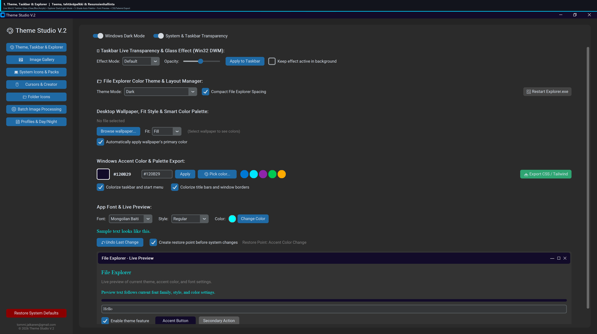
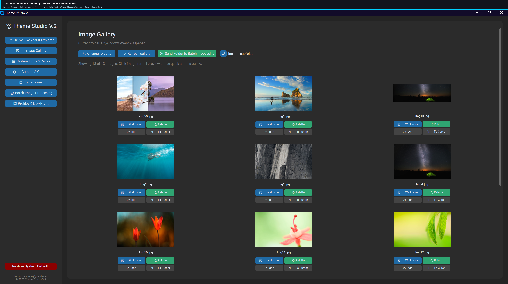
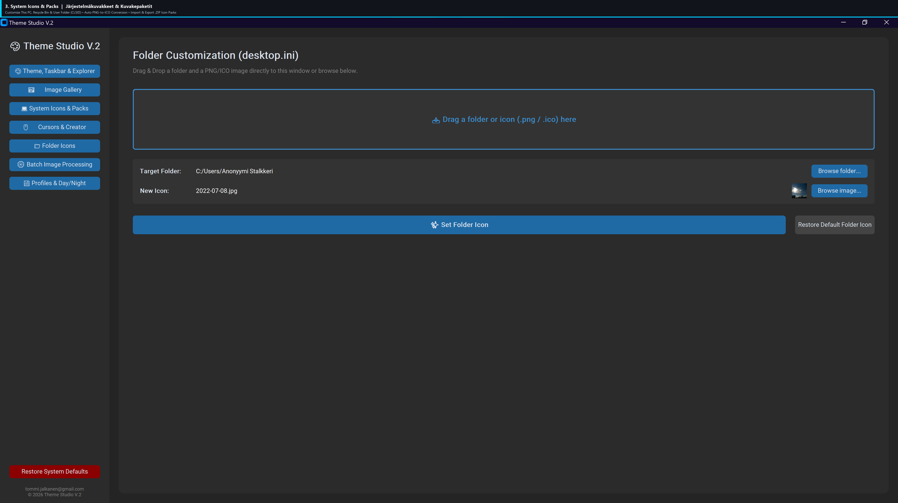
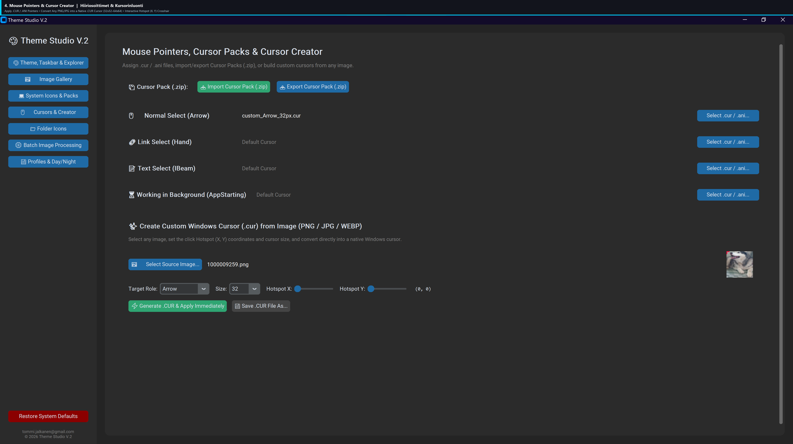
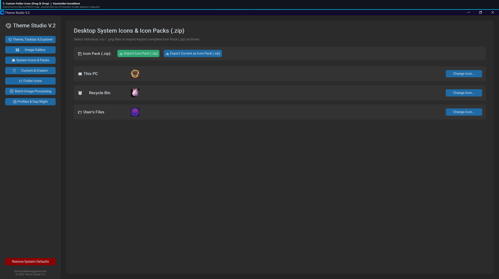
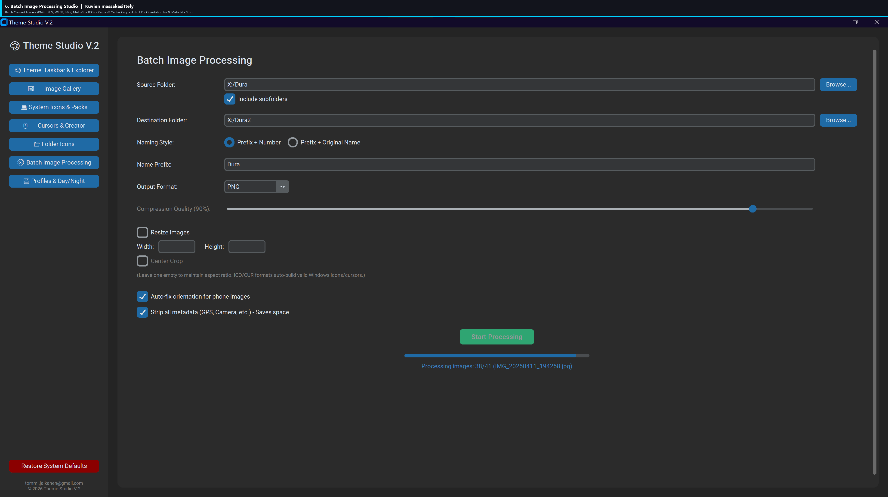
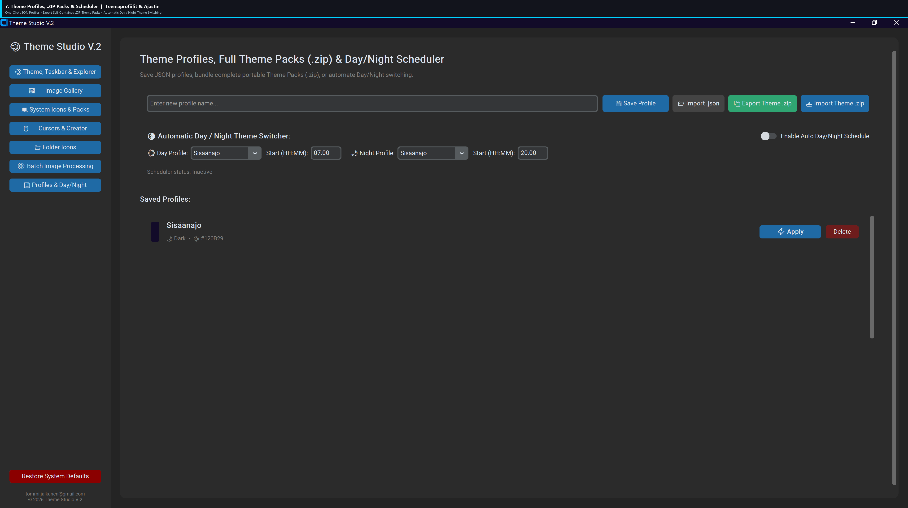

# 🎨 Theme Studio V.2

**Theme Studio V.2** is a comprehensive Windows desktop customization, theming, icon/cursor engineering, and batch image processing suite built with Python, CustomTkinter, and native Win32 APIs.

---

## 🆕 What's New in V2.1 / Uutta versiossa V2.1

* **🎨 Precision Font HEX Input / Tarkka HEX-värisyöttö fonteille:** Set exact typography and UI preview colors using direct HEX code input alongside the color picker. / Määritä fonttien värit tarkasti syöttämällä suoraan HEX-värikoodi.
* **🌍 Fully Bilingual UI (FI / EN) / Täysin kaksikielinen käyttöliittymä:** Automatic system language detection with complete Finnish and English translations across the entire suite. / Täydellinen suomen- ja englanninkielinen käyttöliittymä automaattisella kielentunnistuksella.
* **📦 Updated V2.1 Installer:** Packaged into a clean standalone installer (`ThemeStudio_Installer_v2.1.exe`) via Inno Setup 7. / Valmis asennusohjelma (`ThemeStudio_Installer_v2.1.exe`).

---

## 📸 Visual Tour & User Guide / Kuvallinen käyttöohje

### 1. Theme, Taskbar & Explorer (`01_Theme_and_Taskbar.png`)

* **EN:** Toggle Windows Dark Mode, apply live Win32 Taskbar glass effects (*Clear, Blur, Acrylic*), switch File Explorer color modes and compact spacing, extract a 5-shade accent palette from your wallpaper, preview system fonts with direct HEX color input in real time, and export colors to CSS or Tailwind.
* **FI:** Hallitse Windowsin tummaa tilaa, tehtäväpalkin reaaliaikaisia lasitehosteita (*Clear, Blur, Acrylic*), Resurssienhallinnan teemaa ja tiivistettyä näkymää, taustakuvan 5 sävyn automaattista väripalettia, fonttien esikatselua suoralla HEX-värisyötöllä sekä CSS / Tailwind -koodivientiä.

### 2. Interactive Image Gallery (`02_Image_Gallery.png`)

* **EN:** Browse wallpapers across folders and subfolders, open full-resolution Lightbox previews, extract color palettes without changing your active wallpaper, or send any image directly to the Cursor Creator.
* **FI:** Selaa taustakuvia alikansioineen, avaa kuvat suurennetussa Lightbox-esikatselussa, poimi väripaletti suoraan kuvasta vaihtamatta taustakuvaa tai lähetä kuva yhdellä klikkauksella kursorinluontiin.

### 3. System Icons & Packs (`03_System_Icons.png`)

* **EN:** Customize desktop system icons (*This PC, Recycle Bin, User's Files*) using any `.png` or `.ico` file (automatically converted to multi-size `.ico`), and import or export portable `.zip` Icon Packs.
* **FI:** Mukauta työpöydän järjestelmäkuvakkeet (*Tämä tietokone, Roskakori, Käyttäjän kansio*) suoraan `.png`- tai `.ico`-kuvilla ja tuo tai vie valmiita `.zip`-kuvakepaketteja.

### 4. Mouse Pointers & `.cur` Cursor Creator (`04_Cursors_and_Creator.png`)

* **EN:** Assign custom `.cur` and `.ani` pointers to Windows cursor states, or convert any `.png`/`.jpg` image into a native Windows `.cur` cursor (`32x32`, `48x48`, `64x64`) with an interactive Hotspot `(X, Y)` crosshair preview.
* **FI:** Vaihda Windowsin hiiriosoittimet (`.cur` / `.ani`) tai luo omia aitoja `.cur`-kursoreita suoraan mistä tahansa kuvasta säädettävällä klikkauspisteellä (Hotspot X, Y).

### 5. Custom Folder Icons — Drag & Drop (`05_Folder_Icons.png`)

* **EN:** Drag and drop any folder and a `.png`/`.ico` image directly into the window to generate a multi-size icon and apply it immediately via hidden `desktop.ini` attributes.
* **FI:** Raahaa (Drag & Drop) mikä tahansa kansio ja kuva suoraan ikkunaan, niin ohjelma luo monikokoisen kuvakkeen ja asettaa sen kansiolle automaattisesti `desktop.ini`-määrityksellä.

### 6. Batch Image Processing Studio (`06_Batch_Image_Processing.png`)

* **EN:** Batch convert entire folders of images (`PNG`, `JPEG`, `WEBP`, `BMP`, multi-size `ICO`), resize or center-crop to exact dimensions, auto-fix phone EXIF orientation, and strip metadata to save space.
* **FI:** Muunna kokonaisten kansioiden kuvat eräajona eri formaatteihin (myös monikokoisiksi `.ico`-kuvakkeiksi), muuta kokoa, rajaa keskitetysti, korjaa puhelinkuvien EXIF-asento ja poista metadata.

### 7. Theme Profiles, `.ZIP` Packs & Day/Night Scheduler (`07_Profiles_and_Scheduler.png`)

* **EN:** Save and load complete desktop setups as JSON profiles, bundle self-contained `.zip` Theme Packs (including wallpaper, icons, and cursors) for easy sharing, and schedule automatic Day/Night theme switching.
* **FI:** Tallenna koko työpöydän kokoonpano JSON-profiileiksi, pakkaa kaikki tiedostot jaettavaksi `.zip`-teemapaketiksi tai ajasta teema vaihtumaan automaattisesti päivä- ja yöajan mukaan.

---

## ✨ Key Features in V.2

### 1. 🎨 Theme, Taskbar Transparency & File Explorer Manager
* **System & Explorer Theme Control:** Switch seamlessly between **Dark**, **Light**, and **Mixed (Dark System / Light Apps)** modes, and toggle **Compact File Explorer Spacing**. Includes a one-click `explorer.exe` restart utility.
* **Live Taskbar Transparency & Glass Engine (Win32 DWM):** Apply real-time **Clear Transparent**, **Blur**, **Acrylic**, or **Opaque** composition effects directly to the Windows Taskbar (`Shell_TrayWnd`) with customizable opacity and a background keep-alive option.
* **Smart Wallpaper & 5-Shade Palette Extraction:** Set desktop wallpapers with custom fit modes (*Fill, Fit, Stretch, Tile, Center, Span*) and automatically extract the 5 most vibrant, balanced accent shades into interactive palette buttons.
* **Windows Accent Color Engine:** Dynamically generates a 32-byte 8-shade binary `AccentPalette` and updates DWM title bars, window borders, start menu, and taskbar colors on the fly.
* **Typography, HEX Color Input & Live UI Preview:** Test fonts, styles (*Regular, Bold, Italic, Bold Italic*), and exact HEX colors against a live interactive preview window before applying changes, complete with **Undo** support.
* **Developer Export (CSS / Tailwind / JSON):** Export your active color palette and typography directly into ready-to-use `:root` CSS variables and `tailwind.config.js` snippets.

### 2. 🖼️ Interactive Image Gallery
* **Recursive Wallpaper Browser:** Browse images across folders and subfolders (supports `.jpg`, `.jpeg`, `.png`, `.bmp`, `.webp`).
* **Lightbox Full Preview:** Inspect high-resolution previews and image dimensions in a dedicated modal window.
* **One-Click Actions:** Set any gallery image as your desktop wallpaper, extract its color palette *without* changing your wallpaper, assign it as a folder icon, or send it directly to the Cursor Creator or Batch Processor.

### 3. 💻 Desktop System Icons & Icon Packs (`.zip`)
* **Native CLSID Icon Customization:** Customize desktop icons for **This PC**, **Recycle Bin** (empty & full states), and **User's Files**. Automatically converts `.png` images into multi-resolution `.ico` files (`16x16` up to `256x256`).
* **Icon Pack Import & Export (`.zip`):** Bundle your current system icons into a shareable `.zip` Icon Pack or import and apply external icon packs with one click.

### 4. 🖱️ Mouse Pointers, Cursor Packs (`.zip`) & Image-to-Cursor Creator
* **Custom Cursor States:** Assign `.cur` or `.ani` files to *Normal Select (Arrow)*, *Link Select (Hand)*, *Text Select (IBeam)*, and *Working in Background (AppStarting)*.
* **Built-in Image-to-Cursor (`.cur`) Generator:** Convert any `.png`, `.jpg`, or `.webp` image directly into a native binary Windows `.cur` file. Choose target dimensions (`32x32`, `48x48`, `64x64`) and adjust exact click **Hotspot (X, Y)** coordinates with a live crosshair preview.
* **Cursor Pack Import & Export (`.zip`):** Export your active cursor set to a `.zip` archive or import complete cursor packs.

### 5. 📁 Folder Icon Customizer (`desktop.ini` + Drag & Drop)
* **Smart Drag & Drop:** Drag any folder and `.png`/`.ico` image directly onto the application window to assign custom folder icons.
* **Automatic Attribute & Cache Handling:** Automatically generates hashed `.ico` resources, writes `desktop.ini`, sets `Hidden`/`System`/`Read-Only` Win32 file attributes, and triggers `SHChangeNotify` so Windows Explorer updates immediately.

### 6. ⚙️ Batch Image Processing Studio
* **Bulk Format Conversion:** Convert entire folders (and subfolders) of images into `PNG`, `JPEG`, `WEBP`, `BMP`, multi-size `ICO`, or native Windows `CUR` cursors.
* **Resize & Center Crop:** Maintain aspect ratio automatically or center-crop to exact pixel dimensions.
* **EXIF & Metadata Tools:** Auto-fix smartphone photo orientation and strip EXIF/GPS metadata to save disk space.

### 7. 💾 Theme Profiles, Portable Theme Packs (`.zip`) & Day/Night Scheduler
* **JSON Theme Profiles:** Save and apply your entire desktop state (mode, wallpaper, palette, taskbar effect, icons, cursors, and customized folders) with a single click.
* **Portable Full Theme Packs (`.zip`):** Bundle the JSON profile *along with* all referenced wallpaper, icon, and cursor files into a self-contained `.zip` archive that works across different PCs.
* **Automatic Day / Night Theme Switcher:** Schedule distinct Day and Night profiles to activate automatically at your chosen times (e.g., `07:00` and `20:00`).

---

## 📥 Installation & Building from Source

### Option 1: Standalone Windows Installer (Recommended)
1. Download **`ThemeStudio_Installer_v2.1.exe`** from the [Releases](https://github.com/EliittiSika/ThemeStudio/releases) page.
2. Run the installer to set up Theme Studio V.2 with Start Menu and optional Desktop shortcuts.

### Option 2: Run or Build from Source
* **Prerequisites:** Windows 10 / 11 and Python 3.10+

Install dependencies inside your virtual environment:
```powershell
.\.venv\Scripts\python.exe -m pip install customtkinter pillow windnd pyinstaller